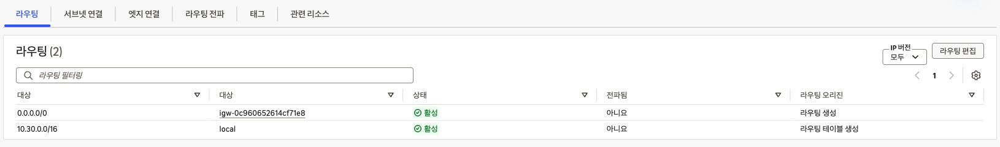
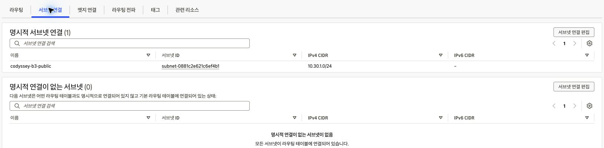
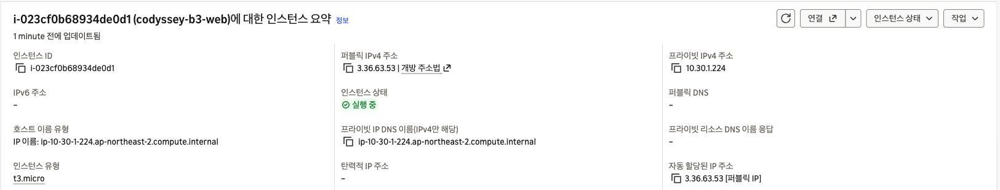
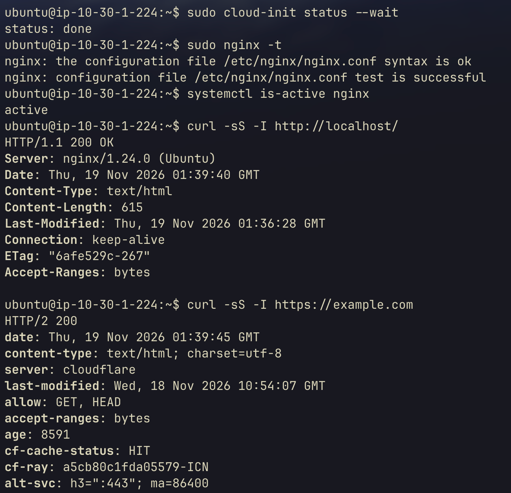
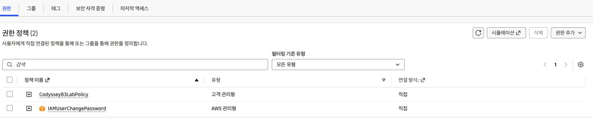
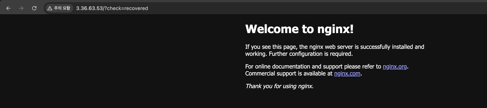
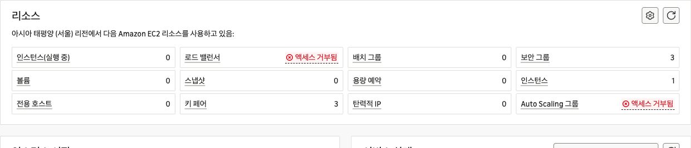

# AWS 웹 서버 배포

AWS VPC의 퍼블릭 서브넷에 배치한 Nginx 웹 서버. HTTP는 전체 공개, SSH는 실습 PC의 공인 IP로 제한한다.

## 1. 네트워크 구성


| 항목 | 설정 |
| --- | --- |
| 리전 / 가용 영역 | `ap-northeast-2` / `ap-northeast-2a` |
| VPC | `codyssey-b3-vpc` · `10.30.0.0/16` |
| Public Subnet | `codyssey-b3-public` · `10.30.1.0/24` |
| Internet Gateway | `codyssey-b3-igw`, VPC에 연결 |
| 라우팅 테이블 | `codyssey-b3-public-rt`, Public Subnet에 연결 |
| 인터넷 경로 | `0.0.0.0/0 → Internet Gateway` |

### 인터넷 경로와 서브넷 연결




## 2. EC2와 웹 서버

| 항목 | 설정 |
| --- | --- |
| 인스턴스 | `codyssey-b3-web` · `t3.micro` 1대 |
| 운영체제 | Ubuntu Server 24.04 LTS |
| 스토리지 | gp3 8GiB, 인스턴스 종료 시 삭제 |
| CPU 크레딧 | Standard |
| 웹 서버 | Nginx 1.24.0 |
| 요금 | 기존 AWS 계정의 종량제 |



### Nginx 설치

EC2 사용자 데이터로 첫 부팅 시 실행한다.

```bash
#!/bin/bash
set -eu
export DEBIAN_FRONTEND=noninteractive
apt-get update
apt-get install -y nginx curl
nginx -t
systemctl enable --now nginx
curl --fail --silent --show-error http://localhost/
```

### SSH 접속과 서버 응답


| 명령 | 결과 |
| --- | --- |
| `sudo cloud-init status --wait` | `status: done` |
| `sudo nginx -t` | 설정 문법 검사 성공 |
| `systemctl is-active nginx` | `active` |
| `curl -sS -I http://localhost/` | `HTTP/1.1 200 OK` |
| `curl -sS -I https://example.com` | `HTTP/2 200`, 인터넷 아웃바운드 통신 성공 |



## 3. 보안 그룹

EC2에 연결된 `codyssey-b3-web-sg`의 인바운드 규칙은 두 개다.

| 용도 | 프로토콜 / 포트 | 허용 소스 |
| --- | --- | --- |
| 웹 접속 | TCP 80 | `0.0.0.0/0` |
| SSH 접속 | TCP 22 | 실습 PC의 공인 IP `/32` |

아웃바운드는 모든 트래픽을 허용한다.


## 4. IAM 권한

네트워크와 EC2를 관리하는 사용자는 `codyssey-b3-lab`이다.

| 정책 | 권한 |
| --- | --- |
| `CodysseyB3LabPolicy` | 서울 리전의 EC2·VPC 조회, 네트워크·보안 그룹·키 페어·인스턴스 관리 |
| `IAMUserChangePassword` | 본인 비밀번호 변경 |

`CodysseyB3LabPolicy`는 관리 작업을 개별 지정하고, `t3.micro` 이외의 인스턴스 생성을 거부한다. 권한의 리소스 범위는 서울 리전 전체이며 `AdministratorAccess`는 연결하지 않는다.



## 5. 외부 접속과 트러블슈팅

### 외부 접속 — 방식 A

| 항목 | 값 |
| --- | --- |
| 접속 방식 | 브라우저 HTTP 접속 |
| 실습 URL | `http://3.36.63.53/` |
| 응답 | **Welcome to nginx!** |
| 검증일 | 2026-11-19 |
| 현재 상태 | 인스턴스 종료, IP 해제 |


### HTTP 인바운드 차단과 복구

| 단계 | 내용 |
| --- | --- |
| 증상 | HTTP 80 규칙 제거 후 새 브라우저 요청이 `ERR_CONNECTION_TIMED_OUT`으로 실패 |
| 가설 | 보안 그룹이 외부 HTTP 연결을 차단 |
| 검증 | Nginx와 라우팅을 유지한 채 HTTP 규칙 제거 전·후·복구 후의 접속 결과 비교 |
| 조치 | HTTP TCP 80 / `0.0.0.0/0` 규칙 복구 |
| 결과 | 새 요청에 **Welcome to nginx!** 페이지 표시 |
| 재발 방지 | 보안 그룹 수정 후 HTTP·SSH 규칙 점검과 외부 접속 테스트 |

**차단 상태**


**복구 상태**



## 6. 리소스 정리

2026-11-19 10:47 KST 기준.

- [x] EC2 종료(Terminated), 실행 중 인스턴스 0개
- [x] 루트 EBS 삭제, 남은 볼륨 0개
- [x] 자동 할당 퍼블릭 IPv4 해제
- [x] Elastic IP 할당 0개
- [ ] Internet Gateway 삭제 — 연결 유지
- [ ] VPC 삭제 — 서브넷·라우팅 테이블·보안 그룹과 함께 유지



