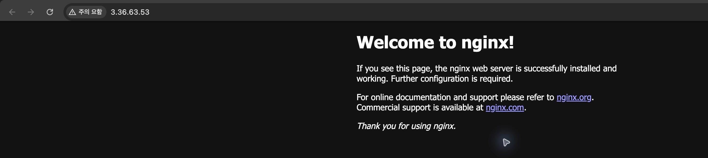

# AWS 웹 서버 배포

서울 리전에 VPC와 퍼블릭 서브넷을 만들고, Ubuntu EC2에 Nginx를 배포했다. 보안 그룹과 IAM으로 접근 범위를 설정한 뒤 SSH 접속, 웹 페이지 표시, HTTP 차단과 복구를 검증했다.

## 1. 네트워크 구성

| 항목 | 설정 |
| --- | --- |
| 리전 / 가용 영역 | `ap-northeast-2` / `ap-northeast-2a` |
| VPC | `codyssey-b3-vpc` · `10.30.0.0/16` |
| Public Subnet | `codyssey-b3-public` · `10.30.1.0/24` |
| Internet Gateway | `codyssey-b3-igw`, VPC에 연결 |
| 라우팅 테이블 | `codyssey-b3-public-rt`, Public Subnet에 연결 |
| 인터넷 경로 | `0.0.0.0/0 → Internet Gateway` |

EC2에 퍼블릭 IPv4를 할당하고, 인터넷 요청이 Nginx의 80번 포트에 도달하도록 구성했다. EC2에서 `https://example.com`으로 요청을 보내 **HTTP 200** 응답을 확인했다.

[네트워크 생성 절차와 설정 화면](docs/setup.md)

## 2. EC2와 웹 서버 배포

| 항목 | 설정 |
| --- | --- |
| 인스턴스 | `codyssey-b3-web` · `t3.micro` 1대 |
| 운영체제 | Ubuntu Server 24.04 LTS |
| 스토리지 | gp3 8GiB, 인스턴스 종료 시 삭제 |
| CPU 크레딧 | Standard |
| 웹 서버 | Nginx 1.24.0 |

[사용자 데이터 스크립트](scripts/user-data.sh)로 Nginx를 설치하고 실행했다. 키 페어로 [SSH 접속](docs/screenshots/17-ssh-login.png)에 성공한 뒤 서버에서 다음을 확인했다.

| 검증 명령 | 결과 |
| --- | --- |
| `sudo cloud-init status --wait` | `status: done` |
| `sudo nginx -t` | 설정 문법 검사 성공 |
| `systemctl is-active nginx` | `active` |
| `curl -sS -I http://localhost/` | `HTTP/1.1 200 OK` |
| `curl -sS -I https://example.com` | `HTTP/2 200` |

[터미널 검증 캡처](docs/screenshots/18-server-checks.png) · [배포와 실행 순서](docs/runbook.md)

## 3. 보안 그룹

`codyssey-b3-web-sg`를 EC2에 연결하고 인바운드를 두 규칙으로 제한했다.

| 용도 | 프로토콜 / 포트 | 허용 소스 |
| --- | --- | --- |
| 웹 접속 | TCP 80 | `0.0.0.0/0` |
| SSH 접속 | TCP 22 | 실습 PC의 공인 IP `/32` |

아웃바운드는 기본값인 모든 트래픽 허용을 사용했다. [보안 그룹 설정 화면](docs/screenshots/10-security-group-ports.jpg)에서 포트 구성을 확인할 수 있다.

## 4. IAM 권한

실습용 IAM 사용자 `codyssey-b3-lab`으로 네트워크와 EC2를 관리했다. 사용자에게 연결한 정책은 다음 두 가지다.

| 정책 | 권한 |
| --- | --- |
| [CodysseyB3LabPolicy](iam-policy.json) | 서울 리전의 EC2·VPC 조회와 생성·변경·삭제, 새 인스턴스는 `t3.micro`로 제한 |
| `IAMUserChangePassword` | 본인 비밀번호 변경 |

관리자 정책 대신 실습에 필요한 작업을 JSON에 지정했다. 리소스 범위는 서울 리전 전체다.

[정책 연결 화면](docs/screenshots/02-iam-attached-policies.jpg)

## 5. 외부 접속과 장애 복구

**방식 A: 브라우저 접속**으로 검증했다. 2026-11-19 `http://3.36.63.53/`에서 **Welcome to nginx!** 페이지를 확인했다. 검증 후 인스턴스를 종료했으며 해당 IP는 해제된 상태다.

보안 그룹의 HTTP 80 규칙을 제거하자 새 요청이 `ERR_CONNECTION_TIMED_OUT`으로 실패했다. 같은 규칙을 복구한 뒤 웹 페이지가 다시 표시되는 것을 확인했다.

[트러블슈팅 보고서](docs/troubleshooting.md)에 증상·가설·검증·조치·결과·재발 방지와 각 단계의 캡처를 기록했다.

## 6. 리소스 정리

기존 개인 AWS 계정의 종량제로 실습했다. 2026-11-19 10:47 KST에 다음 상태를 확인했다.

| 리소스 | 정리 결과 |
| --- | --- |
| EC2 | 종료됨(Terminated), 실행 중 0개 |
| EBS | 루트 볼륨 삭제, 남은 볼륨 0개 |
| 자동 할당 퍼블릭 IPv4 | 해제 완료 |
| Elastic IP | 할당 0개 |
| VPC·서브넷·IGW·라우팅 테이블·보안 그룹 | 유지 |
| IAM 사용자·정책·키 페어 | 유지 |

[리소스 정리 체크리스트와 캡처](docs/cleanup-checklist.md)
