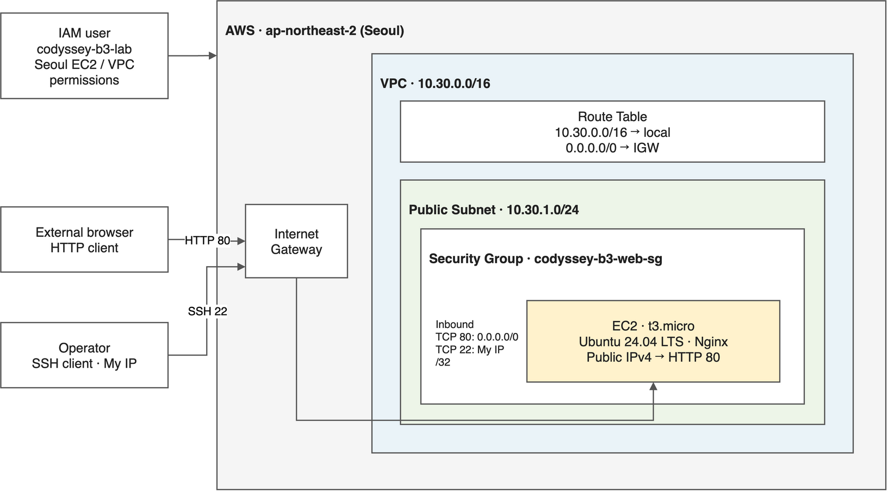

# AWS 웹 서버 배포 실습

서울 리전의 VPC와 Public Subnet에 Ubuntu EC2 한 대를 배치하고, Nginx 기본 페이지를 HTTP로 제공하는 실습이다. 외부 접속 검증은 **방식 A: 브라우저에서 퍼블릭 IP로 접속**을 사용한다.

2026-11-19 SSH 접속, Nginx 실행, 내부·외부 HTTP 응답과 보안 그룹 차단·복구를 검증했다. 검증 후 EC2를 종료하고 EBS 삭제와 자동 퍼블릭 IPv4 해제를 확인했다. IAM과 무료 네트워크는 후속 학습용으로 유지한다.

## 구성

구조도는 실습 당시 배치다. EC2는 검증 후 종료했다. 편집 가능한 [Draw.io 원본](docs/architecture.drawio)과 [SVG](docs/architecture.svg)를 제공한다.

| 항목 | 설정 |
| --- | --- |
| 리전 | 서울 `ap-northeast-2` |
| VPC / Public Subnet | `10.30.0.0/16` / `10.30.1.0/24` |
| 기본 경로 | `0.0.0.0/0 → Internet Gateway` |
| EC2 / OS | `t3.micro`, CPU 크레딧 Standard / Ubuntu Server 24.04 LTS x86_64 |
| 디스크 | gp3 8GiB, 기본 성능, 인스턴스 종료 시 삭제 |
| 보안 그룹 | 인바운드 TCP 80 전체 허용, TCP 22 현재 접속 IP `/32`만 허용 |
| 웹 서버 | Nginx 기본 페이지, HTTP 80 |
| IAM | `codyssey-b3-lab` + `CodysseyB3LabPolicy` |

VPC는 네트워크 범위, 서브넷은 그 안의 주소 구역이다. 라우팅 테이블은 패킷의 다음 목적지를 결정하고 Internet Gateway는 인터넷 통신을 연결한다. EC2의 퍼블릭 IP와 보안 그룹 허용 규칙이 함께 있어야 외부에서 웹 서버로 접속할 수 있다. IAM은 이 리소스를 생성·수정·삭제할 수 있는 사용자의 권한을 정한다.

## 실행 및 검증

[화면별 준비 절차](docs/setup.md)와 [EC2 실행·검증 순서](docs/runbook.md)를 따른다. 인스턴스 시작 시 [설치 스크립트](scripts/user-data.sh)를 사용자 데이터로 넣는다.

| 요구사항 | 확인할 결과 | 상태 |
| --- | --- | --- |
| VPC·서브넷·IGW·기본 경로 | 콘솔 설정 및 구조도 | 생성·연결 완료 |
| IAM 최소권한 | [정책 JSON](iam-policy.json), 정책 연결 화면 | 정책·사용자 생성 완료 |
| HTTP·SSH 접근 제한 | 보안 그룹 규칙 | HTTP 80 전체, SSH 22 내 IP 설정 완료 |
| SSH·Nginx·localhost·외부 통신 | [터미널 캡처](docs/screenshots/18-server-checks.png) | SSH 성공, active, HTTP 200 |
| 외부 접속 | 아래 브라우저 캡처 | Welcome to nginx! 확인 |
| 트러블슈팅 | [보고서](docs/troubleshooting.md) | HTTP 차단 시 timeout, 규칙 복구 후 접속 성공 |
| 과금 리소스 정리 | [체크리스트](docs/cleanup-checklist.md) | EC2 종료, 볼륨 0, Elastic IP 0 |

## 외부 접속 결과

- 방식 A: 브라우저에서 `http://3.36.63.53/` 접속
- 확인일: 2026-11-19, 결과: **Welcome to nginx!**
- 당시 사용한 IP이며 현재는 해제됐다. 현재 서비스 주소로 사용하지 않는다.

[실행 기록](docs/evidence/2026-11-19-session.md)에 시작 시각, 자원 ID, 터미널 결과와 정리 증거를 모았다.

## 비용과 권한

기존 AWS 계정의 종량제로 진행했다. 미션의 **프리 티어 조건은 충족하지 않았다**. 또한 과금 리소스만 정리하기로 하여 **VPC·Internet Gateway 삭제 항목은 미완료**다.

IAM 정책은 서울 리전의 EC2 조회와 실습에 필요한 네트워크·인스턴스 작업만 허용하며, `t3.micro` 외 타입의 인스턴스 생성을 거부한다. S3·RDS·IAM 권한 관리나 `AdministratorAccess`는 포함하지 않는다. 최초 암호 변경을 위한 `IAMUserChangePassword`는 별도로 연결한다. 현재 정책은 리전과 작업을 제한하며, 같은 리전의 리소스를 프로젝트 태그로 격리하는 정책은 아니다.

NAT Gateway, Elastic IP, 로드밸런서, RDS, 도메인, HTTPS, Docker는 사용하지 않는다. EC2와 연결 디스크·IP는 실습 시간에만 사용하고 정리했다. 실제 사용료는 Billing에서 아직 확인하지 않았다.
