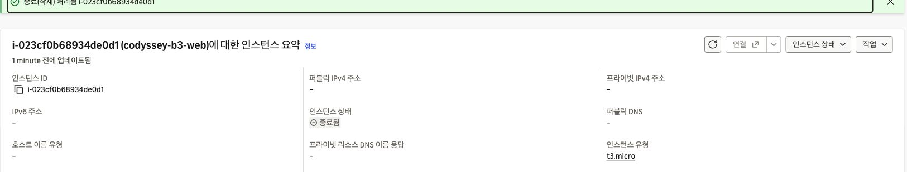
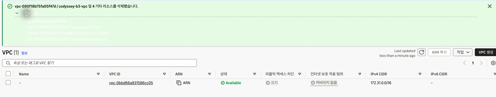

# 리소스 정리 체크리스트

정리일: 2026-11-19 · 서울 리전

- [x] EC2 `i-023cf0b68934de0d1` 종료(Terminated), 실행 중 인스턴스 0개
- [x] 루트 EBS `vol-0b608dce8d3af1b50` 삭제, 남은 볼륨 0개
- [x] 자동 할당 퍼블릭 IPv4 `3.36.63.53` 해제
- [x] Elastic IP 할당 0개
- [x] Internet Gateway `igw-0c960652614cf71e8` 삭제
- [x] 서브넷 `subnet-0881c2e621c6ef4b1` 삭제
- [x] 라우팅 테이블 `rtb-0f5038a4891a1c34f` 삭제
- [x] 보안 그룹 `sg-00ff3bbc8a67ff389` 삭제
- [x] VPC `vpc-080f18b75fa05f47d` 삭제

NAT Gateway·ELB/ALB·RDS는 생성하지 않았다. IAM 사용자·정책과 키 페어는 유지한다.

