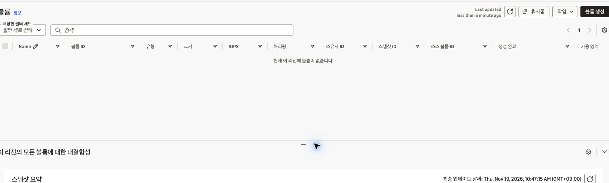
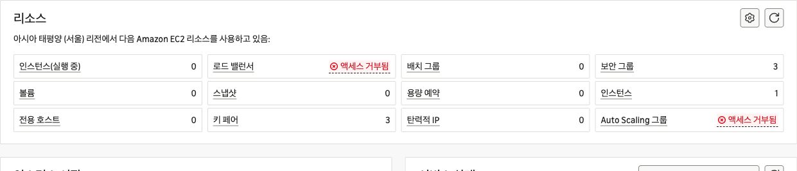

# 리소스 정리 체크리스트

2026-11-19 10:47 KST 서울 리전에서 확인했다. 이번 실습에서 생성한 과금 리소스를 정리하고 IAM과 무료 네트워크는 유지했다.

## 종료·삭제 확인

- [x] SSH·서버 내부 검증·외부 접속·HTTP 차단과 복구 증거 저장
- [x] `codyssey-b3-web` / `i-023cf0b68934de0d1`: **종료됨(Terminated)** 확인
- [x] 루트 EBS `vol-0b608dce8d3af1b50`: 종료 시 삭제 설정, 종료 후 서울 리전 볼륨 **0개** 확인
- [x] 자동 할당 퍼블릭 IPv4 `3.36.63.53`: 인스턴스 상세의 퍼블릭 IPv4가 `–`로 바뀐 것 확인
- [x] Elastic IP: 할당하지 않음, 종료 후 **0개** 확인
- [x] 스냅샷: 생성하지 않음, 종료 후 **0개** 확인
- NAT Gateway·ELB/ALB·RDS: 이번 실습에서 생성하지 않음
- [ ] Billing 실제 사용료 확인: 실습 IAM 사용자에게 조회 권한 없음

대시보드의 전체 인스턴스 1개는 종료된 인스턴스 기록이다. 실행 중 인스턴스는 0개다. 이 실습의 EC2·EBS·퍼블릭 IPv4는 정리됐으며, 실습 중 발생한 사용료는 별도로 청구된다.

## 유지한 리소스

| 리소스 | 이름 / 상태 |
| --- | --- |
| IAM 사용자·정책 | `codyssey-b3-lab`, `CodysseyB3LabPolicy`, `IAMUserChangePassword` |
| VPC | `codyssey-b3-vpc` |
| Public Subnet | `codyssey-b3-public` |
| Internet Gateway | `codyssey-b3-igw`, VPC에 연결 유지 |
| Route Table | `codyssey-b3-public-rt`, 서브넷 연결과 기본 경로 유지 |
| Security Group | `codyssey-b3-web-sg`, HTTP 80·제한된 SSH 22 유지 |
| 키 페어 | `codyssey-b3-key`, 개인키는 Git에서 제외 |

각 네트워크 ID는 [생성 결과](setup.md#5-생성-결과)에 있다. 기존 기본 VPC는 변경하지 않았다. 과금 리소스만 정리하는 범위로 진행했으므로 미션의 **VPC·IGW 삭제 항목은 미완료**다.
