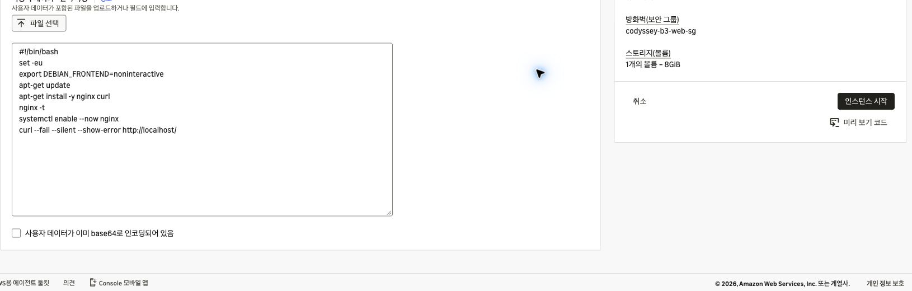
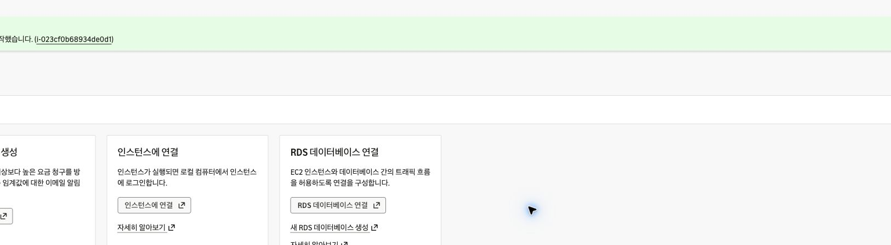
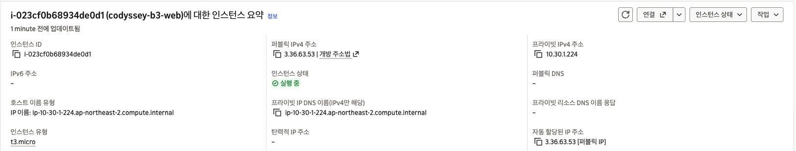
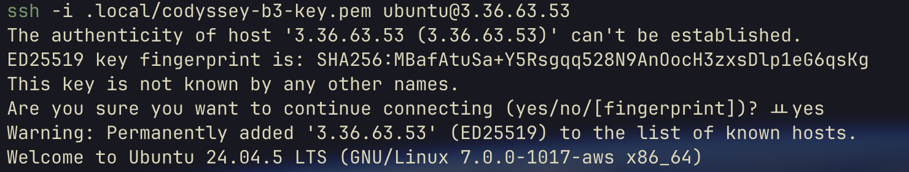
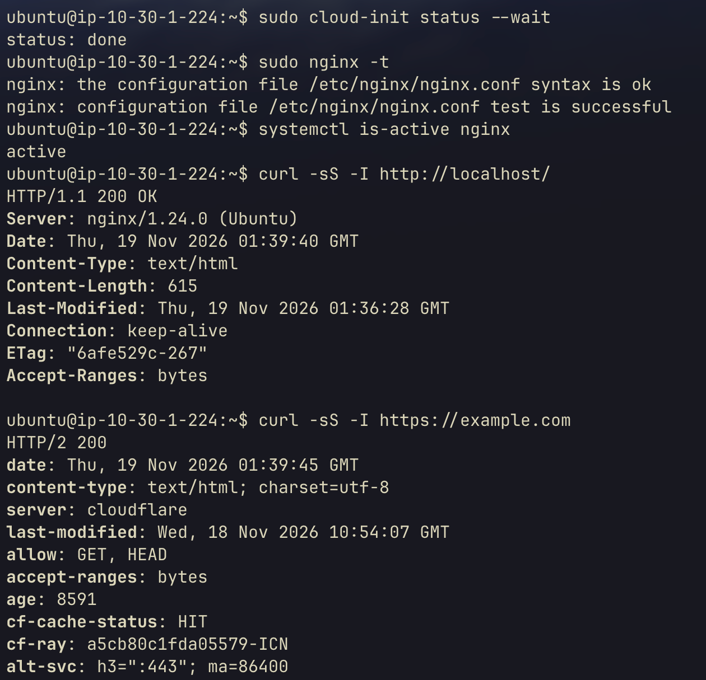

# EC2 배포·검증·정리 기록

## 현재 상태

2026-11-19 10:47 KST 기준 검증과 과금 리소스 정리를 완료했다. 아래 IP와 볼륨은 실습 당시 값이다.

| 항목 | 값 |
| --- | --- |
| 인스턴스 | `i-023cf0b68934de0d1` / `codyssey-b3-web` |
| 퍼블릭 IPv4 | `3.36.63.53` |
| 프라이빗 IPv4 | `10.30.1.224` |
| 루트 EBS | `vol-0b608dce8d3af1b50`, gp3 8GiB, 종료 시 삭제 |
| AMI | `ami-0e0eaae1fc96ade32`, Ubuntu 24.04 LTS x86_64 |
| 인스턴스 유형 | `t3.micro`, 크레딧 `standard` |
| 키 페어 | `codyssey-b3-key` |
| 네트워크 | 기존 `codyssey-b3-vpc` / `codyssey-b3-public` / `codyssey-b3-web-sg` |

01:37:43 UTC에 SSH 접속, cloud-init 완료, Nginx 설정 검사, 서비스 active, localhost HTTP 200, example.com HTTPS 200을 확인했다. 출력은 [서버 검증 기록](01-server-validation.txt)에 저장했다.

브라우저에서 `http://3.36.63.53/`의 Welcome to nginx! 페이지를 확인했다. [외부 접속 캡처](../screenshots/16-external-nginx.jpg).

## 검증과 정리

- 10:39 KST 사용자가 SSH 접속, cloud-init done, nginx 설정 검사 성공, active, localhost HTTP 200, example.com HTTPS 200을 직접 확인했다. [SSH 캡처](../screenshots/17-ssh-login.png), [검증 캡처](../screenshots/18-server-checks.png).
- HTTP 80 규칙 제거 → 외부 요청 timeout → 규칙 복구 → 브라우저 정상 표시를 확인했다. [트러블슈팅 보고서](../troubleshooting.md).
- EC2 시작 시각은 콘솔 기준 **10:35:53 KST**다. 10:47 KST까지 종료 상태, EBS 0개, Elastic IP 0개, 자동 퍼블릭 IPv4 해제를 확인했다.
- IAM·VPC·서브넷·IGW·라우팅·보안 그룹·키 페어는 유지했다. [정리 체크리스트](../cleanup-checklist.md).

## 생성과 서버 검증 화면

## 콘솔 경고

EC2 생성 화면에서 `ec2:GetSecurityGroupsForVpc` 권한이 없어 보안그룹 유효성 검사 경고가 표시됐다. 지정한 보안그룹으로 인스턴스 생성은 성공했다. Compute Optimizer 조회도 권한 범위 밖이어서 상세 화면에서 접근 거부가 표시됐다. IAM 정책은 변경하지 않았다.
