# 사전 준비 절차

진행일: 2026-11-18~19. 유료 리소스를 생성하기 전에 IAM과 네트워크를 준비한다. 화면은 실제 콘솔에서 캡처하며 비밀번호와 개인키를 포함하지 않는다.

## 1. 계정과 비용 확인

Billing → Credits에서 사용 가능한 크레딧과 예상 잔액이 모두 `US$0.00`, 활성 크레딧이 0개임을 확인했다. 이 단계는 텍스트 확인 기록이며 당시 화면 캡처는 없다.

기존 AWS 계정에서 종량제로 진행한다. VPC·서브넷·라우팅 테이블·Internet Gateway·보안 그룹·IAM 구성만 먼저 준비하고, EC2·EBS·퍼블릭 IPv4는 실습 시작 시 생성한다.

서울 VPC 대시보드의 준비 전 상태는 VPC 1개, 서브넷 4개, 라우팅 테이블 1개, Internet Gateway 1개, 보안 그룹 1개였다. 실행 중 EC2, Elastic IP와 NAT Gateway는 각각 0개였다. 기존 기본 네트워크는 유지하고 별도 실습 VPC를 사용한다.

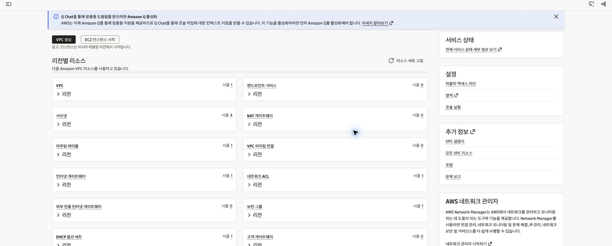

## 2. 실습용 IAM 정책

IAM → 정책 → 정책 생성 → JSON에서 [iam-policy.json](../iam-policy.json)을 입력하고 `CodysseyB3LabPolicy`라는 이름으로 생성했다.

- 허용 서비스: EC2 API에 포함되는 인스턴스·VPC·서브넷·라우팅·보안 그룹·키 페어 관리
- 리전: `ap-northeast-2`로 제한
- 인스턴스 생성: `t3.micro`만 허용
- 관리자 권한, S3·RDS 관리, IAM 권한 부여 작업은 제외
- EC2 조회는 `ec2:Describe*`, 변경 작업은 JSON의 명시적 목록만 허용
- 리소스 범위는 서울 리전 전체이므로 다른 프로젝트의 리소스는 작업 대상으로 선택하지 않는다.

정책 생성만으로는 사용자에게 권한이 부여되지 않는다. 다음 단계에서 사용자와 연결한다.

## 3. IAM 사용자와 콘솔 로그인

IAM → IAM 사용자 → 사용자 생성에서 다음과 같이 설정했다.

| 설정 | 값 |
| --- | --- |
| 사용자 이름 | `codyssey-b3-lab` |
| 콘솔 액세스 | 활성화 |
| 최초 암호 | AWS 자동 생성 |
| 다음 로그인 시 새 암호 생성 | 필수 |
| 연결 정책 | `CodysseyB3LabPolicy`, `IAMUserChangePassword` |
| 액세스 키 | 생성하지 않음 |

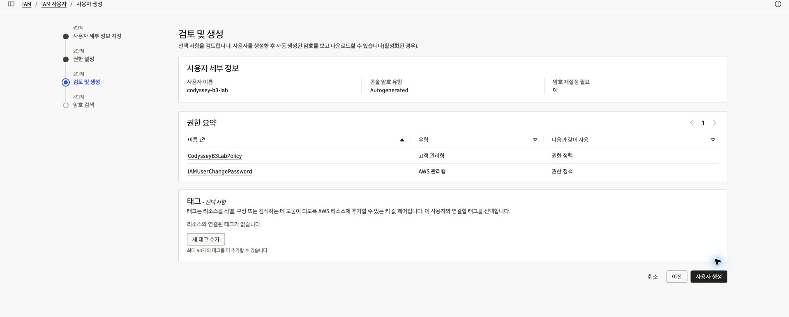

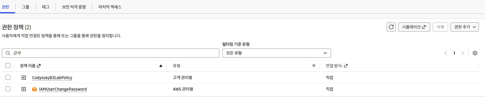

사용자 생성 성공을 확인했다. 최초 로그인은 AWS 계정 ID, IAM 사용자 이름, 임시 암호로 진행하고 새 암호를 설정한다. IAM의 Account ID는 사용자 이름이 아니라 상위 AWS 계정 번호다. 이 계정 번호와 암호는 문서에 저장하지 않는다.

2026-11-19 새 비밀번호 설정을 마친 사용자의 로그인 상태를 확인했다. 서울 리전으로 이동한 뒤 아래 네트워크 구성을 완료했다.

이후 실습은 루트 사용자가 아닌 `codyssey-b3-lab`으로 진행한다. 실습 사용자에게는 IAM 조회·관리 권한이 없으므로 IAM 대시보드에서 접근 거부가 나타날 수 있다. VPC·EC2 콘솔에서 실습을 진행한다.

## 4. 네트워크 구성

### VPC 생성

VPC → VPC 생성에서 **VPC만**을 선택했다. 이름은 `codyssey-b3-vpc`, IPv4 CIDR은 `10.30.0.0/16`, IPv6는 없음, 테넌시는 기본값으로 지정했다. VPC와 함께 기본 라우팅 테이블·네트워크 ACL·기본 보안 그룹이 생성된다.

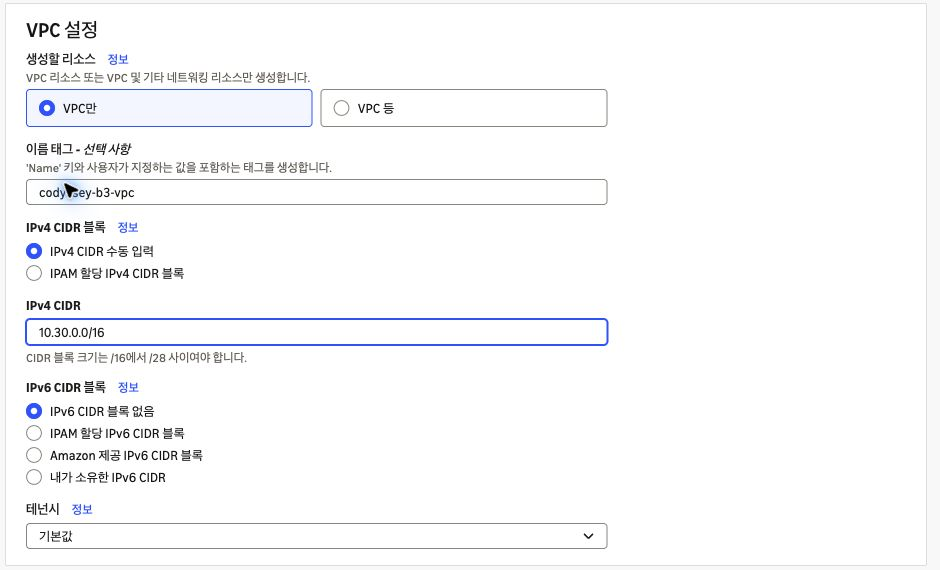
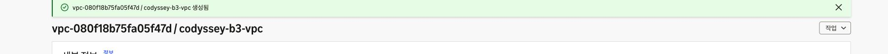

### 서브넷 생성

서브넷 → 서브넷 생성에서 실습 VPC를 선택했다. 이름 `codyssey-b3-public`, 가용 영역 `ap-northeast-2a`, IPv4 CIDR `10.30.1.0/24`로 생성했고 `Available` 상태를 확인했다.

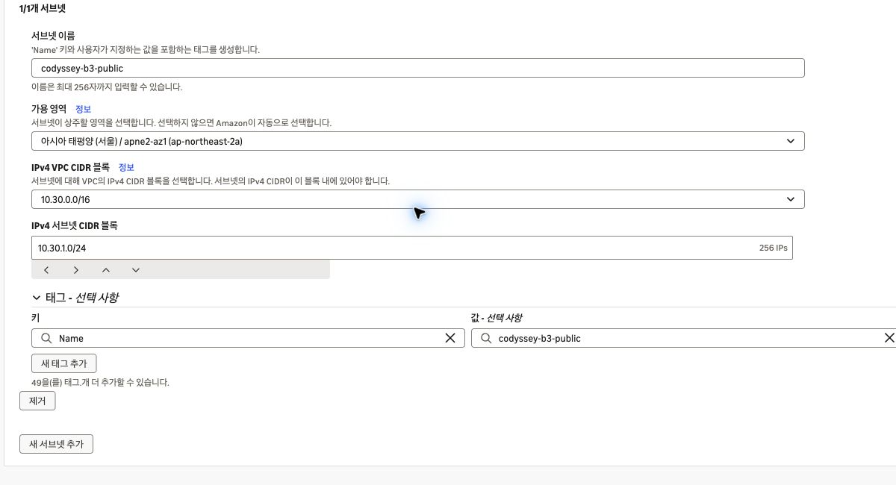

### 인터넷 게이트웨이 연결

인터넷 게이트웨이 → 인터넷 게이트웨이 생성에서 `codyssey-b3-igw`를 만들었다. 생성 후 **VPC에 연결**에서 `codyssey-b3-vpc`를 선택했고 상태가 `Attached`로 바뀌었다.

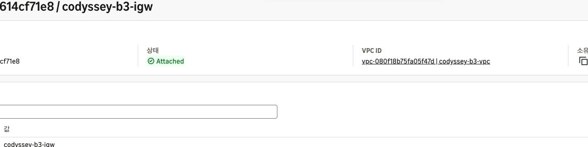

### 라우팅 테이블과 서브넷 연결

1. 라우팅 테이블 → 생성에서 `codyssey-b3-public-rt`와 실습 VPC를 지정했다.
2. 라우팅 → 라우팅 편집 → 라우팅 추가에서 목적지 `0.0.0.0/0`, 대상 유형 **인터넷 게이트웨이**, 대상 `codyssey-b3-igw`를 선택하고 저장했다.
3. 서브넷 연결 → 서브넷 연결 편집에서 `codyssey-b3-public`을 체크하고 저장했다.

`10.30.0.0/16 → local`은 VPC 내부 통신 경로다. 추가한 `0.0.0.0/0 → IGW`가 인터넷 방향 경로이며, 이 테이블을 연결하면서 해당 서브넷이 퍼블릭 서브넷이 된다. 외부 접속에는 이후 EC2의 퍼블릭 IP와 보안 그룹도 필요하다.

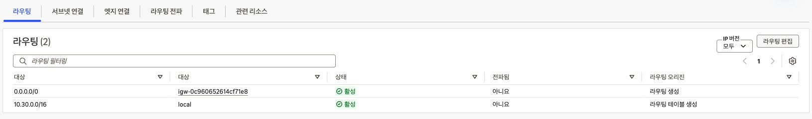
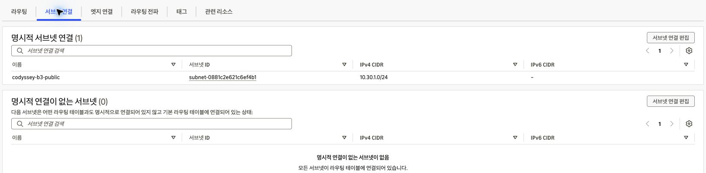

### 보안 그룹 생성

보안 그룹 → 보안 그룹 생성에서 이름 `codyssey-b3-web-sg`, 설명 `B3 lab HTTP public and SSH from my IP`, VPC `codyssey-b3-vpc`를 지정했다.

| 방향 | 유형 | 포트 | 소스 또는 대상 |
| --- | --- | --- | --- |
| 인바운드 | HTTP / TCP | 80 | Anywhere-IPv4: `0.0.0.0/0` |
| 인바운드 | SSH / TCP | 22 | **내 IP**로 선택한 현재 공인 IP `/32` |
| 아웃바운드 | 모든 트래픽 | 전체 | 기본값 `0.0.0.0/0` |

두 인바운드 규칙과 아웃바운드 규칙 1개가 저장된 것을 확인했다. 준비 단계에서는 연결된 EC2가 없었다. SSH 소스는 다음 실습 장소나 네트워크가 달라지면 새 **내 IP**로 갱신한다. 아래 캡처는 개인 IP가 있는 소스 열을 제외한 포트 설정이다.

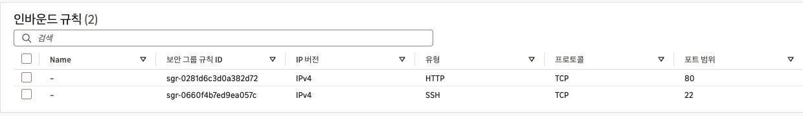

## 5. 생성 결과

2026-11-19 서울 리전에서 확인한 실습 리소스다.

| 리소스 | 이름 | ID |
| --- | --- | --- |
| VPC | `codyssey-b3-vpc` | `vpc-080f18b75fa05f47d` |
| Public Subnet | `codyssey-b3-public` | `subnet-0881c2e621c6ef4b1` |
| Internet Gateway | `codyssey-b3-igw` | `igw-0c960652614cf71e8` |
| Public Route Table | `codyssey-b3-public-rt` | `rtb-0f5038a4891a1c34f` |
| Security Group | `codyssey-b3-web-sg` | `sg-00ff3bbc8a67ff389` |

VPC 자동 생성 기본 라우팅 테이블은 `rtb-0d150afa4798883b2`다. 기본 테이블에는 인터넷 경로를 추가하지 않았으며 실습 서브넷은 위 사용자 지정 테이블에 연결했다.

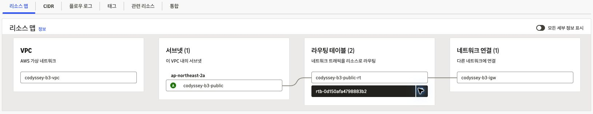

대시보드에서 전체 VPC 2개, 서브넷 5개, 라우팅 테이블 3개, IGW 2개, 보안 그룹 3개를 확인했다. 실행 중인 EC2·Elastic IP·NAT Gateway는 각각 0개다. 이번 준비에서는 EC2·EBS·퍼블릭 IPv4를 생성하지 않았다.

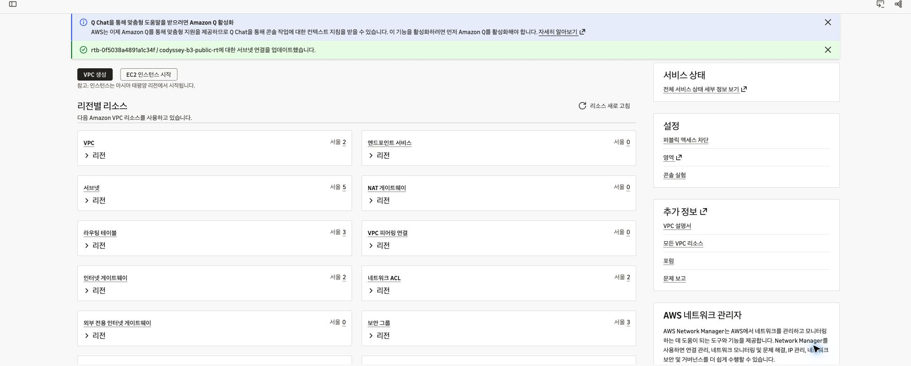

## EC2 실습과 정리

같은 날 [EC2 실행 가이드](runbook.md)에 따라 배포·검증하고 과금 리소스를 정리했다. [실행 기록](evidence/2026-11-19-session.md)에서 생성·SSH 접속·Nginx 검증 캡처를, [트러블슈팅](troubleshooting.md)에서 HTTP 차단과 복구를, [정리 체크리스트](cleanup-checklist.md)에서 종료·삭제 결과를 확인할 수 있다.

## 공식 참고

- [VPC의 인터넷 연결](https://docs.aws.amazon.com/vpc/latest/userguide/working-with-igw.html)
- [EC2 IAM 작업 및 조건](https://docs.aws.amazon.com/service-authorization/latest/reference/list_ec2.html)
- [IAM 비용 안내](https://docs.aws.amazon.com/IAM/latest/UserGuide/introduction.html)
- [VPC 요금 안내](https://aws.amazon.com/vpc/pricing/)
