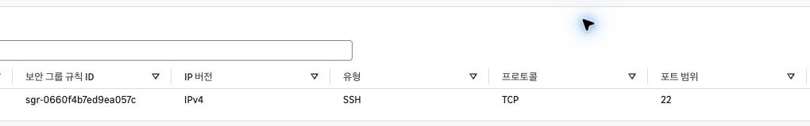
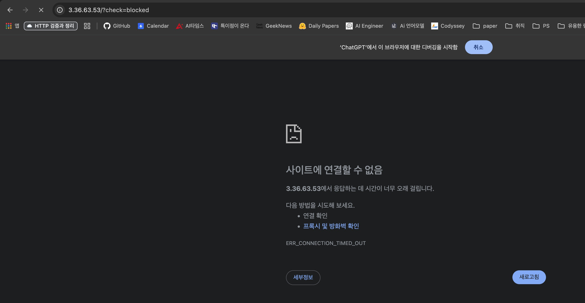
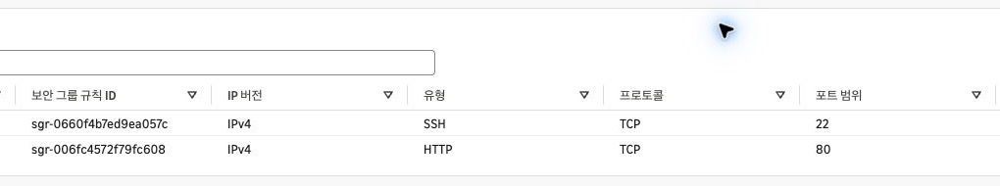
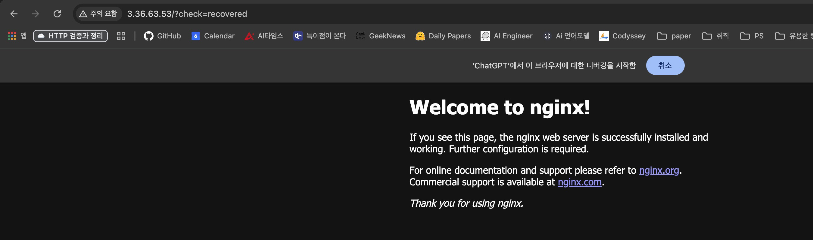

# HTTP 인바운드 차단과 복구

2026-11-19 실습 서버 `i-023cf0b68934de0d1`에서 보안 그룹 규칙을 변경해 장애를 재현했다. 웹 서버와 라우팅은 변경하지 않았다.

| 단계 | 확인 내용 |
| --- | --- |
| 정상 기준 | SSH 접속 성공, Nginx `active`, localhost HTTP 200, 외부 브라우저에 Welcome to nginx! 표시 |
| 증상 재현 | `codyssey-b3-web-sg`의 HTTP TCP 80 / `0.0.0.0/0` 규칙만 제거하고 SSH 22 규칙 유지 |
| 원인 가설 | HTTP 허용 규칙이 없어 외부에서 들어오는 새 연결이 차단됨 |
| 검증 | `http://3.36.63.53/?check=blocked` 새 요청이 `ERR_CONNECTION_TIMED_OUT`으로 실패 |
| 조치 | HTTP TCP 80 / `0.0.0.0/0` 규칙을 다시 추가하고 저장 |
| 결과 | `http://3.36.63.53/?check=recovered`에서 Welcome to nginx! 재표시 |
| 재발 방지 | 배포 후 HTTP 허용 범위와 SSH 소스 IP를 각각 확인하고 외부 브라우저로 새 요청 수행 |

## 재현 증거

정상 상태의 서버 내부 검증은 [터미널 캡처](screenshots/18-server-checks.png)에 있다. 차단 중 서버 내부 명령은 추가로 실행하지 않았다. 보안 그룹 변경 전·후·복구 후의 외부 요청을 비교했다. Nginx와 라우팅을 바꾸지 않고 HTTP 규칙 복구만으로 접속이 회복됐다.
